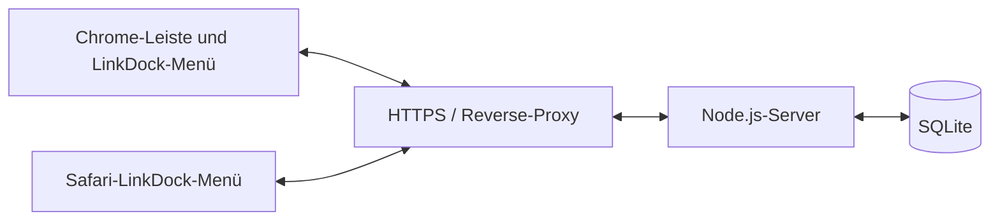

# Architektur und API



## Server

Ein kleiner Node.js-HTTP-Dienst ohne externe npm-Abhängigkeiten spricht SQLite über das Kommandozeilenprogramm an. Die Sammlung liegt in einer einzelnen Snapshot-Zeile. Eine atomare SQL-Anweisung aktualisiert nur dann, wenn die erwartete Revision noch stimmt. Eingaben werden validiert und SQL-Textwerte als UTF-8-Hexliterale übertragen.

| Methode | Pfad | Verhalten |
|---|---|---|
| GET | `/health` | Öffentlicher Dienst- und Datenbankcheck |
| GET | `/api/snapshot` | Aktuelle Revision und Sammlung |
| PUT | `/api/snapshot` | Sammlung bei passender Ausgangsrevision ersetzen |

Alle API-Zugriffe außer `/health` benötigen `Authorization: Bearer <lokaler Schlüssel>`. Der Vergleich erfolgt über Hashes mit `timingSafeEqual`. Schreibzugriffe verwenden `Content-Type: application/json`.

Beispiel eines Snapshots ohne echte Nutzerdaten:

```json
{
  "revision": 0,
  "items": [
    {
      "id": "example-bookmark",
      "type": "bookmark",
      "title": "Beispiel",
      "parentId": null,
      "position": 0,
      "url": "https://example.com/"
    }
  ]
}
```

Ordner haben `type: "folder"` und `url: null`. IDs sind stabil. `parentId: null` bedeutet oberste Ebene. Ordner müssen existieren, Zyklen sind unzulässig. Maximal 5000 Einträge und 1 MiB JSON pro Schreibanfrage; Titel maximal 1000 und URLs maximal 8192 Zeichen. Nur HTTP(S)-URLs.

Bei veralteter Revision folgt HTTP 409 ohne Datenänderung. Fehlerhafte Schlüssel führen zu 401, ungültige Daten zu 400. Nach unklarer Netzwerkantwort lädt der Client erneut, bevor er wieder schreibt.

## Zusammenführung

Jeder Client speichert drei Zustände: letzte gemeinsame Ausgangskopie, lokale Sammlung und zuletzt geladener Serverstand. Änderungen werden nach ID und Feld verglichen:

- Nur auf einer Seite verändert: diese Änderung übernehmen.
- Beide Seiten identisch verändert: übernehmen.
- Verschiedene Felder verändert: kombinieren.
- Dasselbe Feld unterschiedlich verändert oder Löschen gegen Bearbeiten: anhalten und Konflikt anzeigen.
- Ungültige Ordnerstruktur nach Kombination: ebenfalls anhalten.

Löschungen werden durch die Differenz zur Ausgangskopie erkannt. Der Server speichert keine Tombstone-Historie und keine älteren Versionen. Er ist deshalb auf die persistente Ausgangskopie der Clients angewiesen. Ein neuer Client übernimmt zunächst den Serverstand.

Lokale Änderungen werden vor Netzwerkzugriff gespeichert. Hintergrundzugriffe werden innerhalb der jeweiligen Erweiterungsinstanz serialisiert. Chrome-Ereignisse lösen einen verzögerten Abgleich aus; zusätzlich gibt es Alarme, Browserstart und manuelles Abgleichen.

## Chrome-Adapter

Die native Leiste wird in ein neutrales Datenmodell übersetzt. Beim ersten Import werden passende bestehende Einträge einmalig zugeordnet; danach existiert eine persistente Zuordnung zwischen Chrome-ID und LinkDock-ID.

Chrome bietet keine atomare Transaktion über viele Lesezeichen. Vor dem Übertragen wird daher ein Zwischenstand gespeichert. Nach Unterbrechung bleibt der Vorgang angehalten, bis der Nutzer bewusst einen Stand auswählt. Ordner werden nie mit einer rekursiven Zwangslöschung entfernt: Überlebende Kinder werden zuerst verschoben, unbekannte oder spezielle Kinder bleiben erhalten.

## Browser-Builds

Gemeinsamer Quellcode liegt in `extension/shared`. Nur `browser.mjs` und `native.mjs` unterscheiden sich je Plattform. Der Build legt diese Dateien nebeneinander in `dist/chrome` bzw. `dist/safari`. Dadurch bleiben Oberfläche, Löschdialog und Synchronisierung in beiden Varianten gleich.

Safari besitzt keinen nativen Lesezeichenadapter. Sein Adapter reicht nur die gemeinsame Sortierung weiter und verändert keine Safari-Lesezeichen. Die Browser-API wird über `browser` oder `chrome` angesprochen, je nach Plattform.
